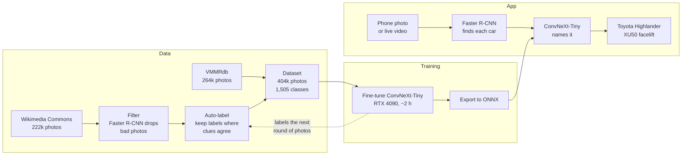

# Car Identifier

Point your phone at a car and it names it: make, model, generation and facelift, from a
photo or a live camera feed. I built the whole pipeline, from collecting and cleaning 220k+
photos to training the model on my own GPU and serving it from a Java web app. It gets the
**make and model right 95.8%** of the time across **1,505 car classes** (40,287 test photos
it never saw), and says "Not sure" instead of guessing. I also published the 222,832
photos I collected as a [free dataset](https://huggingface.co/datasets/timdwms/us-car-models-1948-2026).

## How it works

## Technologies

- **ML:** Python, PyTorch, timm (ConvNeXt-Tiny), torchvision (Faster R-CNN), ONNX
- **App:** Java 17, Spring Boot, Jetty, ONNX Runtime, GWT + SmartGWT, Maven
- **Hardware:** trained on an RTX 4090, Ryzen 9 9950X3D, 61 GB RAM

## Data

| Dataset | Photos | Download |
|---|---|---|
| My Commons dataset: 555 US car models, 1948-2026 | 222,832 | [Hugging Face](https://huggingface.co/datasets/timdwms/us-car-models-1948-2026) |
| VMMRdb | ~285k | [Official source](https://github.com/faezetta/VMMRdb) (not redistributed here) |

## Credits

- **Wikimedia Commons photographers**: every photo's author and license is listed in the
  dataset's `metadata.csv`.
- **VMMRdb**: F. Tafazzoli, H. Frigui, K. Nishiyama, "A Large and Diverse Dataset for Improved
  Vehicle Make and Model Recognition", CVPR Workshops 2017.
- **NHTSA vPIC**: the US government's vehicle list, used to measure coverage.
- **Pretrained models**: ConvNeXt-Tiny (Meta AI, via timm) and Faster R-CNN (torchvision,
  trained on COCO).
